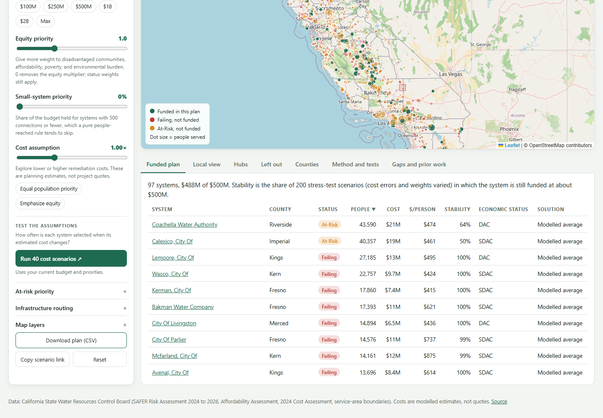
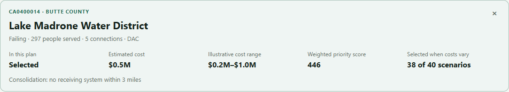

# California v1: five-minute demonstration and practitioner review

Prepared locally on 2026-11-11 Pacific. Start using [SETUP.md](../SETUP.md); no public release or outreach is assumed. The saved model and input snapshot are unchanged. Evidence: [captures and membership](demo/evidence.json), the CSVs beside the images, and [release QA](RELEASE_REVIEW.md).

## Walkthrough

1. **Budget decision — one minute.** Open `http://127.0.0.1:8885/#b=500`, or Reset and choose $500M. Defaults are equity 1, exploratory five-year weight, no reserve, routes off and cost multiplier 1. The plan selects **97 systems / 476,663 modeled people / $487,919,470 modeled cost**; 48 selected systems have at most 500 connections. The screen rounds cost to $488M. Explain that upward $250,000 cost units can leave some budget unused. This is a weighted allocation objective, not a promise that everyone counted will benefit.
2. **Small-system tradeoff — one minute.** Keep the other controls fixed and raise Small-system priority to **30%** (`#b=500&r=0.3`). The selection becomes **112 systems / 393,742 modeled people / $486,059,328 cost**, including **70 small systems**. That is 22 more small systems and 82,921 fewer modeled people. This demonstrates the chosen priority rule rather than a superior outcome. The reserve first allocates within a small-system sub-budget, then optimizes what remains; it does not guarantee a globally optimal reserve-constrained solution or spending exactly 30%.
3. **Stability — one minute.** Return to defaults. The saved robustness is about **96%**: 93 of the 97 selected systems appear in at least half of the 200 saved scenarios. It is sensitivity to saved assumptions, not an outcome probability. Search **CA0400014 / Lake Madrone Water District**, then Run 40 cost scenarios. In the recorded run, **81 of 97** selected systems appeared in at least 80% of those 40 runs; Lake Madrone appeared **38 of 40**. The 40 runs vary system costs at current controls; they differ from the saved 200 runs that also vary equity and horizon. Changing controls cancels/invalidates the current result. Reserve, routing, fixed-share or changed cost-multiplier controls hide incompatible saved stability; use a fresh 40-run check.
4. **Approximate routes — 45 seconds, optional.** Set equity 2, reserve 30% and enable cheaper consolidation route costs (`#b=500&l=2&r=0.3&c=1`). This combined example selects **114 systems / 394,101 modeled people / $485,850,493 cost**, including 72 small systems. It changes several assumptions, so do not attribute the difference to equity alone. The green routes are straight-line distance ×1.3 approximations costed from state unit costs. Receiver capacity, willingness, street alignment and construction feasibility remain unresolved. Draw routes switches the same effective routes in both maps.
5. **CSV handoff — 45 seconds.** Download plan (CSV). Compare the exact budget, selected-system count, modeled population, effective cost and scenario controls in the comment header. Compare a system's selected status/cost/weight to the table or card. The export retains the snapshot ID, full effective cost precision, fixed share or forecast weight, and blank stored stability where incompatible. Lines beginning `#` are metadata; skip them when importing as a data table. The file contains selected systems, not a complete census of systems excluded from the plan.

## Plain-language explanation to use

“This prototype explores funding choices across California's saved Failing and At-Risk system list. Reach adds the populations of the systems selected by the objective. It is modeled population, not measured intervention benefit, and population overlap is unresolved. Costs come from state averages and scaling rather than project quotes. Routes are geographic approximations. The forecast supplies exploratory snapshot weights: previously examined 2025→2026 outcomes are diagnostic, annual failure probabilities remain unvalidated, and the multi-year calculation assumes constant annual risk and is unvalidated too.”

Do not describe the selection as an agency recommendation, claim validated annual risk, or treat the status-first comparator as the state's actual allocation process. Fixed-share mode offers a manual At-Risk discount; it does not validate the forecast. More selected systems can accompany less modeled population.

## Captured examples

| Same $500M budget | Systems | Small systems | Modeled people | Modeled cost |
|---|---:|---:|---:|---:|
| Defaults | 97 | 48 | 476,663 | $487,919,470 |
| Reserve 30%, all other defaults | 112 | 70 | 393,742 | $486,059,328 |
| Equity 2 + reserve 30% + routes | 114 | 72 | 394,101 | $485,850,493 |

Desktop 3D, mobile and forced-failure screenshots are in `release-qa/browser/`. These are actual local captures, not design mockups.

## Short practitioner checklist — not yet completed by a practitioner

Record reviewer role, date, scenario, observed issue and its consequence. Do not request or record an endorsement by default.

- [ ] Do the selected/left-out examples resemble systems a funder would discuss? Identify a concrete implausible inclusion or exclusion.
- [ ] Are the modeled costs and uncertainty useful for screening? Which project quotes, regional adjustments or operations costs would change the decision?
- [ ] Does the small-system reserve/equity tradeoff express a defensible priority? Is the distinction between weighted objective and unweighted reach understandable?
- [ ] Would readiness, technical assistance, affordability or willingness reverse an example selection?
- [ ] Is any proposed consolidation receiver or route implausible? Capacity, street alignment, legal boundaries and community consent need independent checks.
- [ ] Are the diagnostic forecast, horizon assumption and stability explanations clear enough to prevent reading them as validated annual risk or intervention benefit?
- [ ] Can the reviewer operate controls, inspect a system and import the CSV? Note device/browser and accessibility needs.
- [ ] What minimum missing evidence would be required before using this in a real funding conversation?

Outreach remains a [draft](../OUTREACH.md). Any sending, sharing/publication or public quotation requires separate authorization/permission. Missing annual validation requires original dated releases, publication histories and complete failure episodes, including recovered systems; additional interface work cannot supply them.
